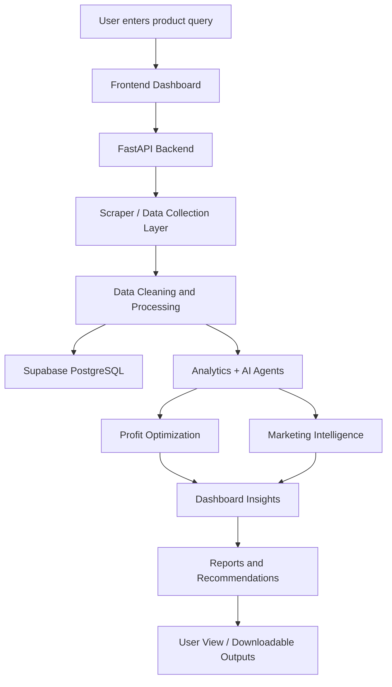

# StrategAI

StrategAI is an AI-powered e-commerce profit optimization platform built to help businesses evaluate products, compare suppliers, analyze market pricing, and choose better sourcing and selling strategies. The system brings together a FastAPI backend, a React + Vite frontend, Supabase/PostgreSQL storage, and Ollama-powered AI services to deliver product intelligence and decision support.

It is designed for users who want to:
- analyze product opportunities
- compare wholesale and retail data
- understand supplier quality and pricing
- estimate profitability and market viability
- generate strategic recommendations using AI
- track marketing and reporting insights in one dashboard

---

## What this project does

StrategAI processes a product query and turns it into actionable business intelligence. The workflow typically includes:

1. User enters a product or keyword in the frontend.
2. The backend triggers scraping and data collection services.
3. Product, supplier, and market data are cleaned and normalized.
4. Analytics and AI agents evaluate pricing, competition, and profit potential.
5. Recommendations are surfaced through the dashboard and reports.
6. Users can review strategy and marketing insights for better decision-making.

In short, the project helps answer questions such as:
- Is this product worth sourcing?
- Who are the best suppliers?
- What is the market price range?
- What margin can I expect?
- Which strategy is likely to be most profitable?

---

## Key features

- Product search and product intelligence
- Wholesale supplier analysis
- Retail competitor benchmarking
- Profit and margin estimation
- AI-powered strategic recommendations
- Marketing intelligence support
- Report generation for business insights
- Dashboard analytics with charts and summaries
- Authentication and protected user sessions
- Supabase-based persistence and data access
- Dockerized local deployment for fast setup
- Cloud deployment support for production environments

---

## Tech stack

### Frontend
- React
- Vite
- TypeScript
- Tailwind CSS
- React Router
- Recharts
- TanStack Query
- Axios
- Supabase client
- Framer Motion

### Backend
- Python
- FastAPI
- PostgreSQL / Supabase
- Playwright
- BeautifulSoup
- lxml
- Ollama
- Pydantic
- Docker

### Infrastructure
- Docker Compose
- Supabase
- Ollama
- Vercel for frontend hosting
- Render for backend hosting

---

## System architecture

The project is structured as a full-stack AI business intelligence application with separated frontend, backend, and data services.

```text
┌──────────────────────┐
│      User / Browser  │
└──────────┬───────────┘
           │
           ▼
┌──────────────────────┐
│   React + Vite UI    │
│   Dashboard / Reports │
└──────────┬───────────┘
           │ HTTP / API calls
           ▼
┌──────────────────────┐
│   FastAPI Backend    │
│   Routes + Services  │
│   AI + Analytics     │
└──────────┬───────────┘
           │
           ├──────────────► Scraping / Data Collection
           │
           ├──────────────► Analytics / AI Agents
           │
           ├──────────────► Supabase / PostgreSQL
           │
           └──────────────► Reports / Recommendations
```

---

## Project flow diagram



---

## Repository structure

```bash
fyp_Strategai/
├── .env.example
├── .gitignore
├── docker-compose.yml
├── README.md
├── QUICK_SETUP.md
├── ENV_FILE_REQUIRED.md
├── SUPABASE_SETUP.md
├── implementation_plan.md
├── render.yaml
├── start.bat
├── start.ps1
├── backend/
│   ├── .env.example
│   ├── Dockerfile
│   ├── requirements.txt
│   ├── app/
│   │   ├── agents/
│   │   ├── api/
│   │   ├── config/
│   │   ├── core/
│   │   ├── models/
│   │   ├── scheduler/
│   │   ├── services/
│   │   └── main.py
│   ├── db/
│   ├── scripts/
│   └── tests/
├── frontend/
│   └── salik-frontend/
│       ├── src/
│       ├── package.json
│       ├── Dockerfile
│       ├── .env.example
│       ├── vite.config.ts
│       └── README.md
├── docs/
│   ├── ENVIRONMENT_SETUP_GUIDE.md
│   ├── DOCKER_GUIDE.md
│   ├── CI_CD_GUIDE.md
│   ├── DEPLOYMENT_GUIDE.md
│   ├── CLOUD_DEPLOYMENT_GUIDE.md
│   └── ...
└── ...
```

---

## Environment requirements

### Software required
- Python 3.10+
- Node.js 18+
- npm
- Docker and Docker Compose
- Git
- Supabase project access
- Ollama instance or reachable LLM endpoint
- Modern browser

### Required environment variables

Copy the example files before running the project:

```bash
cp .env.example .env
cp backend/.env.example backend/.env
cp frontend/salik-frontend/.env.example frontend/salik-frontend/.env
```

#### Root `.env`
- `SUPABASE_URL`
- `SUPABASE_KEY`
- `SUPABASE_SERVICE_KEY`
- `SUPABASE_DB_URL`
- `APIFY_API_TOKEN`
- `APIFY_API_KEY`
- `SCRAPERAPI_KEY`
- `OLLAMA_BASE_URL`
- `OLLAMA_MODEL`
- `PORT`
- `LOG_LEVEL`
- `CORS_ORIGINS`
- `VITE_API_BASE_URL`
- `VITE_SUPABASE_URL`
- `VITE_SUPABASE_ANON_KEY`

#### Backend `.env`
- `SUPABASE_URL`
- `SUPABASE_KEY`
- `SUPABASE_SERVICE_KEY`
- `SUPABASE_DB_URL`
- `OLLAMA_BASE_URL`
- `OLLAMA_MODEL`
- `PORT`
- `LOG_LEVEL`
- `CORS_ORIGINS`

#### Frontend `.env`
- `VITE_API_BASE_URL`
- `VITE_SUPABASE_URL`
- `VITE_SUPABASE_ANON_KEY`

---

## How to run the project

### Option 1: Run with Docker Compose

This is the easiest and recommended option for local development:

```bash
docker compose up --build
```

Once started, open:
- Frontend: http://localhost:5173
- Backend: http://localhost:8001

Health checks:

```bash
curl http://localhost:8001/health
curl http://localhost:8001/readiness
curl http://localhost:8001/liveness
```

---

### Option 2: Run the backend manually

```bash
cd backend
python -m venv .venv
source .venv/bin/activate   # Windows: .venv\Scripts\activate
pip install -r requirements.txt
uvicorn app.main:app --host 0.0.0.0 --port 8001 --reload
```

Backend URL:

```bash
http://localhost:8001
```

---

### Option 3: Run the frontend manually

```bash
cd frontend/salik-frontend
npm install
npm run dev
```

Frontend URL:

```bash
http://localhost:5173
```

---

## Production deployment targets

This repository is structured for deployment in production as follows:
- Frontend: Vercel
- Backend: Render
- Database: Supabase PostgreSQL
- LLM runtime: Ollama

---

## Application behavior

StrategAI combines multiple steps into an end-to-end decision workflow:

1. Search for a product or supply opportunity.
2. Collect supplier, market, and retail pricing information.
3. Clean and structure raw data for analysis.
4. Run AI and analytics models to detect revenue and margin opportunities.
5. Surface recommendations through the dashboard.
6. Generate reporting outputs for business users.

This makes it useful for product evaluation, sourcing analysis, and commercial decision support.

---

## Notes

- The project uses Ollama for local LLM inference and analysis tasks.
- Supabase handles database storage and related application data.
- The backend exposes modular API routes for scraper, analytics, marketing, health, and reports.
- The frontend is organized as a dashboard-style app with multiple user flows and protected pages.

---

## Summary

StrategAI is a full-stack AI-powered e-commerce intelligence system that converts product and market data into practical business decisions. By combining scraping, analysis, AI recommendations, and reporting, it helps users understand supplier opportunities, customer pricing trends, and profitability in a streamlined workflow.

---

## Project status

This repository is a research and product-focused full-stack application designed for academic use, business experimentation, and extension into a production-ready commercial platform.
