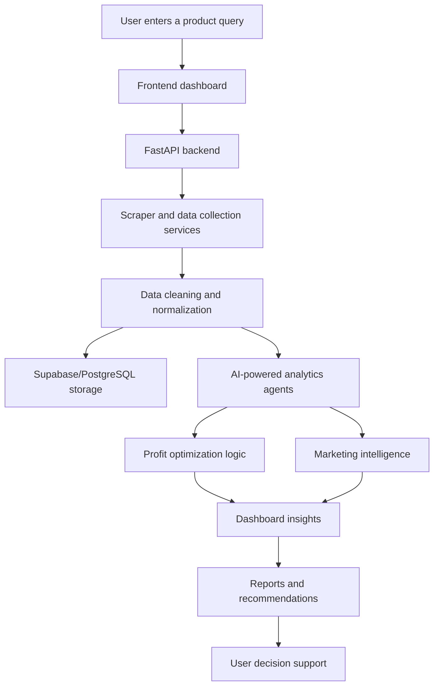

# StrategAI

<div align="center">
  
  
  
  
  
</div>

<p align="center">
  <strong>AI-powered e-commerce profit optimization platform</strong>
</p>

StrategAI is a full-stack intelligent product analytics system built to help users research products, evaluate suppliers, compare market prices, and make more profitable sourcing and selling decisions through AI-guided analysis.

This project combines web scraping, backend intelligence, analytics pipelines, and a modern dashboard to transform raw e-commerce data into practical business recommendations.

---

## Why this project matters

Modern e-commerce decisions often depend on fragmented information from multiple sources: supplier listings, competitive pricing, product quality, and profit margins. StrategAI brings that information into one workflow so users can evaluate product opportunities faster and make clearer commercial decisions.

The system helps answer questions like:
- Is a product worth sourcing?
- Which supplier offers the best value?
- How competitive is the current market?
- What margin and pricing strategy will work best?
- Which marketing direction is more promising?

---

## Project highlights

- AI-assisted product intelligence
- Supplier and wholesale comparison
- Retail market analysis
- Profitability and margin estimation
- Strategic recommendation engine
- Marketing insight generation
- Report-ready business summaries
- Authenticated dashboard experience
- Supabase-backed persistence
- Dockerized local development workflow

---

## Architecture overview

```text
┌──────────────────────────────┐
│       User Interaction       │
│   React + Vite Dashboard     │
└──────────────┬───────────────┘
               │
               ▼
┌──────────────────────────────┐
│       FastAPI Backend        │
│  API routes + services       │
│  analytics + AI workflows    │
└───────┬──────────────┬───────┘
        │              │
        ▼              ▼
┌──────────────┐  ┌──────────────────────┐
│ Scraper Layer │  │ Supabase/PostgreSQL │
│ product data  │  │ structured storage   │
└──────┬───────┘  └──────────┬───────────┘
       │                     │
       └──────────────┬──────┘
                      ▼
             ┌────────────────────┐
             │ AI + Analytics     │
             │ recommendation     │
             │ & report logic    │
             └─────────┬──────────┘
                       ▼
             ┌────────────────────┐
             │ Dashboard Insights │
             │ Reports & Strategy  │
             └────────────────────┘
```

---

## System flow



---

## Tech stack

### Frontend
- React
- Vite
- TypeScript
- Tailwind CSS
- React Router
- Recharts
- TanStack Query
- Axios
- Framer Motion

### Backend
- Python
- FastAPI
- Pydantic
- Playwright
- BeautifulSoup
- lxml
- PostgreSQL / Supabase
- Ollama

### DevOps / deployment
- Docker Compose
- Vercel
- Render
- GitHub Actions friendly structure

---

## Repository structure

```bash
fyp_Strategai/
├── .env.example
├── docker-compose.yml
├── README.md
├── QUICK_SETUP.md
├── ENV_FILE_REQUIRED.md
├── SUPABASE_SETUP.md
├── implementation_plan.md
├── render.yaml
├── start.bat
├── start.ps1
├── backend/
│   ├── .env.example
│   ├── Dockerfile
│   ├── requirements.txt
│   ├── app/
│   │   ├── agents/
│   │   ├── api/
│   │   ├── config/
│   │   ├── core/
│   │   ├── models/
│   │   ├── scheduler/
│   │   ├── services/
│   │   └── main.py
│   ├── db/
│   ├── scripts/
│   ├── tests/
│   └── ...
├── frontend/
│   └── salik-frontend/
│       ├── src/
│       ├── package.json
│       ├── Dockerfile
│       ├── .env.example
│       ├── vite.config.ts
│       └── README.md
├── docs/
│   ├── ENVIRONMENT_SETUP_GUIDE.md
│   ├── DOCKER_GUIDE.md
│   ├── CI_CD_GUIDE.md
│   ├── DEPLOYMENT_GUIDE.md
│   ├── CLOUD_DEPLOYMENT_GUIDE.md
│   └── ...
└── ...
```

---

## What the app does in practice

StrategAI turns a simple product idea into business insight. A user can search for a product, let the system gather relevant data, analyze price ranges and supplier conditions, and receive strategic recommendations that support better commercial decisions.

It is useful for:
- sourcing evaluation
- market research
- profit potential analysis
- competitor benchmarking
- product prioritization
- decision support for digital commerce teams

---

## Environment requirements

### Required software
- Python 3.10+
- Node.js 18+
- npm
- Docker + Docker Compose
- Git
- Supabase project access
- Ollama endpoint or local LLM runtime

### Setup env files

```bash
cp .env.example .env
cp backend/.env.example backend/.env
cp frontend/salik-frontend/.env.example frontend/salik-frontend/.env
```

Required values include:
- Supabase URL and keys
- PostgreSQL connection string
- Ollama base URL and model
- API credentials for scraping services
- Frontend and backend CORS/origin config

---

## Run locally

### Option 1: Full stack with Docker

```bash
docker compose up --build
```

Open:
- Frontend: http://localhost:5173
- Backend: http://localhost:8001

Check health:

```bash
curl http://localhost:8001/health
curl http://localhost:8001/readiness
curl http://localhost:8001/liveness
```

### Option 2: Backend only

```bash
cd backend
python -m venv .venv
source .venv/bin/activate   # Windows: .venv\Scripts\activate
pip install -r requirements.txt
uvicorn app.main:app --host 0.0.0.0 --port 8001 --reload
```

### Option 3: Frontend only

```bash
cd frontend/salik-frontend
npm install
npm run dev
```

---

## Deployment targets

- Frontend: Vercel
- Backend: Render
- Database: Supabase PostgreSQL
- AI runtime: Ollama

---

## Why this is a strong portfolio project

This project demonstrates:
- full-stack product development
- Python + JavaScript ecosystem integration
- AI-powered workflow design
- database and API architecture
- deployment readiness
- real-world business problem solving
- practical product thinking beyond a simple demo

It is a strong example of a capstone or portfolio-grade project because it combines product design, backend engineering, AI implementation, and deployment strategy in one cohesive system.

---

## Future directions

- improved analytics accuracy
- user personalization
- richer visual dashboards
- broader marketplace support
- exportable strategy reports
- automated periodic data refreshes
- multi-product portfolio analysis

---

## Summary

StrategAI is more than a web app; it is a decision-support platform for e-commerce intelligence. It brings together data collection, AI analysis, strategic recommendations, and a polished frontend into a single system that helps users move from raw product information to actionable business insight.

---

<p align="center">
  <a href="https://github.com/hudarizwan/fyp_Strategai">
    
  </a>
</p>
